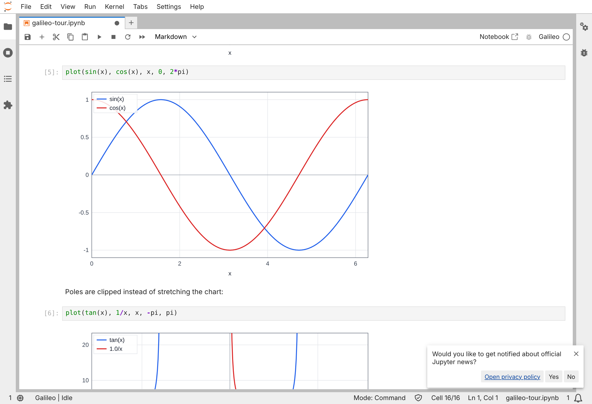

[](https://github.com/cascala/igalileo/issues)

# iGalileo

[iGalileo](https://github.com/cascala/igalileo) is a [Galileo](https://github.com/cascala/galileo) kernel for Jupyter, so you can use Galileo, a computer algebra system written in Scala, in notebooks: symbolic algebra, calculus, matrices, tensors and plots.



Each line of a cell is one Galileo statement, and every result is shown. `plot(...)` and `parametric(...)` render as SVG charts. Tab completion covers Galileo's functions and the variables you defined. A tour is in [examples/galileo-tour.ipynb](examples/galileo-tour.ipynb).

## Quick start: JupyterLab in Docker

The `cascala/igalileo` image contains JupyterLab with the Galileo kernel. Nothing else is needed besides Docker:

```
docker run --rm -p 8888:8888 -v "$PWD:/home/galileo/notebooks/work" cascala/igalileo
```

Open the `http://127.0.0.1:8888/lab?token=...` link that it prints. The tour notebook is in the file browser; your current directory is mounted as `work/`, so notebooks you save there stay on your machine.

Options:
* a fixed token instead of a random one: add `-e JUPYTER_TOKEN=mysecret` before the image name
* the classic Notebook interface: add `notebook` after the image name

## Using your own Jupyter, with the kernel in Docker

If you already run Jupyter on your machine, you can install just the kernel. It starts in a container each time a notebook opens:

1. Copy [igalileo/kernel.json](igalileo/kernel.json) to a new folder `galileo` in your Jupyter kernels directory:
   * Mac: `~/Library/Jupyter/kernels/galileo/kernel.json`
   * Linux: `~/.local/share/jupyter/kernels/galileo/kernel.json`
   * Windows: `%APPDATA%\jupyter\kernels\galileo\kernel.json`
2. Edit it so the first argument is the absolute path of [igalileo/run_docker.sh](igalileo/run_docker.sh) (keep that script executable).
3. `jupyter kernelspec list` should now show `galileo`. Start Jupyter and pick "Galileo (Docker)".

`run_docker.sh` uses `cascala/igalileo:latest`; set `IGALILEO_IMAGE` to use another tag.

## Building from source

Requirements: JDK 17 or later and [sbt](https://www.scala-sbt.org/).

iGalileo needs Galileo 0.2.0, which is not on Maven Central yet, so publish it locally first:

```
git clone https://github.com/cascala/galileo.git && (cd galileo && sbt publishLocal)
git clone https://github.com/cascala/igalileo.git && cd igalileo
sbt test stage
```

This produces `target/universal/stage/bin/igalileo`. To use it with your Jupyter, point `kernel.json` at [igalileo/run_sbt.sh](igalileo/run_sbt.sh) or straight at that launcher, with `"{connection_file}"` as the second argument.

### Building the Docker image

The image builds Galileo from source, passed in as a named build context:

```
docker build --build-context galileo=../galileo -t cascala/igalileo .
# or straight from GitHub:
docker build --build-context galileo=https://github.com/cascala/galileo.git -t cascala/igalileo .
```

The image's entry point takes `lab` (default), `notebook`, or `kernel CONNECTION_FILE` (used by `run_docker.sh`).

## How it works

The kernel is a JVM process that speaks the [Jupyter messaging protocol](https://jupyter-client.readthedocs.io/en/latest/messaging.html) (version 5.3) over ZeroMQ, using [JeroMQ](https://github.com/zeromq/jeromq), and evaluates code with Galileo's parser and expression handler in-process. Plots are sent as `display_data` with `image/svg+xml` and a text fallback.

Feedback and bug reports are welcome as [issues](https://github.com/cascala/igalileo/issues/new).
