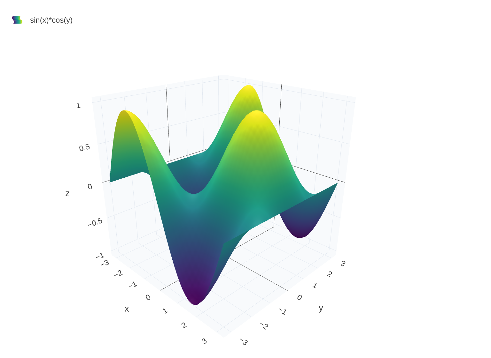

[](https://github.com/cascala/igalileo/issues)

# iGalileo

iGalileo is a Jupyter kernel for [Galileo](https://github.com/cascala/galileo-rs), a computer algebra system written in Rust. In a notebook you can do symbolic algebra, calculus, matrices, number theory and differential geometry, with interactive 2D and 3D plots.

**▶ [Try Galileo in your browser](https://cascala.github.io/igalileo/)**: nothing to install. Open the [playground](https://cascala.github.io/igalileo/playground/), start the [first lesson](https://cascala.github.io/igalileo/playground/#lesson/foundations/01-numbers), or use [notebooks in JupyterLite](https://cascala.github.io/igalileo/lab/lab/index.html).




## Try it in your browser, no install

**[cascala.github.io/igalileo](https://cascala.github.io/igalileo/)** runs Galileo entirely in your browser: everything runs locally, with nothing to install.

* [Playground](https://cascala.github.io/igalileo/playground/): a light REPL with the learning paths as interactive lessons. Works on a phone, and the Share button makes a link that replays your session.
* [Notebooks](https://cascala.github.io/igalileo/lab/lab/index.html): JupyterLite (JupyterLab in the browser) with the Galileo kernel and all the example notebooks. Notebooks you create are saved in your browser's storage.

## Quick start: JupyterLab in Docker

The `cascala/igalileo` image bundles JupyterLab and the Galileo kernel. It runs natively on Intel (amd64) and Apple Silicon (arm64), and Docker is all you need:

```
docker run --rm -p 8888:8888 -v "$PWD:/home/galileo/notebooks/work" cascala/igalileo
```

Open the `http://127.0.0.1:8888/lab?token=...` link it prints. The example notebooks appear in the file browser. Your current directory is mounted as `work/`, so notebooks you save there stay on your machine.

Options:
* For a fixed token instead of a random one, add `-e JUPYTER_TOKEN=mysecret` before the image name.
* For the classic Notebook interface, add `notebook` after the image name.
* To get the latest image, run `docker pull cascala/igalileo`.

## Using Galileo in a notebook

How Galileo is written (statements, numbers, operators, functions, matrices, strings, lists, records and blocks) is described in the [Galileo language reference](https://github.com/cascala/galileo-rs/blob/main/docs/language.md), and every command is listed in the [command reference](https://github.com/cascala/galileo-rs/blob/main/docs/builtins.md). Both are also on the web site: [cascala.github.io/igalileo/reference](https://cascala.github.io/igalileo/reference/). In a notebook:

* Each line of a cell is one Galileo statement, and each result is shown. End a line with `;` to hide its result.
* `load(file.gg)` runs a script and shows its results in the cell. Files are found next to the notebook, so in Docker put scripts in the mounted `work/` folder and load them from a notebook saved there.
* Symbolic results, metrics and curvature tensors are typeset with LaTeX.
* Plots (`plot`, `plot3d`, `surface` and the others in the [command reference](https://github.com/cascala/galileo-rs/blob/main/docs/builtins.md#plotting)) are interactive: you can zoom, pan, and rotate 3D plots.
* Notebooks also store an SVG copy of each plot, so they display on GitHub and in other viewers.
* `help` lists all commands, and `help(name)` explains one. Shift+Tab on a name shows the same text.
* Tab completes Galileo's functions and the variables you defined.

### Example notebooks

* [A tour of Galileo](examples/galileo-tour.ipynb): numbers, simplification, calculus, 2D and 3D plotting, matrices
* [Differential geometry and physics](examples/differential-geometry-tour.ipynb): curvature of surfaces, geodesics in 3D, the Schwarzschild black hole, Mercury's perihelion precession, light bending, GPS clocks, the pendulum and the Lorenz attractor

### Learning paths

* [Differential geometry](examples/differential-geometry/README.md), seven notebooks: curves, metrics, surfaces, Gaussian curvature, parallel transport, geodesics and the Riemann tensor
* [General relativity](examples/general-relativity/README.md), nine notebooks: spacetime, the equivalence principle, Einstein's equations, black holes, Mercury's orbit, light bending, GPS, gravitational waves and cosmology

More notebooks go in [examples/](examples/), and the Docker image includes all of them. The learning-path notebooks are generated from the text sources in [examples/src](examples/src) with `python3 examples/src/build.py`, then executed with `examples/src/execute.sh` so that their results and plots are stored with them.

## Using your own Jupyter, with the kernel in Docker

If Jupyter already runs on your machine, you can install just the kernel. It starts in a container each time a notebook opens.

1. Copy [igalileo/kernel.json](igalileo/kernel.json) into a new folder named `galileo` in your Jupyter kernels directory:
   * Mac: `~/Library/Jupyter/kernels/galileo/kernel.json`
   * Linux: `~/.local/share/jupyter/kernels/galileo/kernel.json`
   * Windows: `%APPDATA%\jupyter\kernels\galileo\kernel.json`
2. Edit it so the first argument is the absolute path to [igalileo/run_docker.sh](igalileo/run_docker.sh). Keep that script executable.
3. Check that `jupyter kernelspec list` shows `galileo`, then start Jupyter and pick "Galileo (Docker)".

`run_docker.sh` uses `cascala/igalileo:latest`. Set `IGALILEO_IMAGE` to use a different tag. For interactive plots in your own JupyterLab, also run `pip install plotly`. Without it you get the SVG version.

## Without Docker

Install the engine with Rust's `cargo`, then the kernel with `pip`:

```
cargo install --git https://github.com/cascala/galileo-rs   # puts `galileo` on your PATH
pip install "git+https://github.com/cascala/igalileo#subdirectory=kernel"
python -m galileo_kernel.install --user
```

Start Jupyter and pick "Galileo". Set `GALILEO_BIN` if `galileo` is not on your `PATH`.

### Building the Docker image

The image builds the engine from source, which it receives as a named build context:

```
docker build --build-context galileo=../galileo-rs -t cascala/igalileo .
# or straight from GitHub:
docker build --build-context galileo=https://github.com/cascala/galileo-rs.git -t cascala/igalileo .
```

To build and push for Intel and Apple Silicon at once, see [NOTES](NOTES). The image's entry point takes `lab` (the default), `notebook`, or `kernel CONNECTION_FILE`, which `run_docker.sh` uses.

## The web site

The site lives in `site/` (landing page and playground) and `lite/` (the JupyterLite kernel extension and build). `lite/build.sh` builds the engine for WebAssembly from [galileo-rs](https://github.com/cascala/galileo-rs), runs every example notebook through it, builds the kernel extension and JupyterLite, renders the language reference from galileo-rs `docs/` into `reference/` (with `lite/reference.mjs`), and writes the static site to `_site/`:

```
pip install -r lite/requirements.txt          # needs Rust with wasm32-unknown-unknown and Node 20+
lite/build.sh ../galileo-rs                   # or no argument to clone galileo-rs
python3 -m http.server -d _site 8000
```

The `Web site` GitHub Actions workflow runs the same script and publishes to GitHub Pages when `site/`, `lite/` or `examples/` change on master, and every night, so the engine and its reference on the site follow galileo-rs. To publish a galileo-rs change sooner, run it by hand from the Actions tab.

## How it works

The mathematics happens in the `galileo` executable from [galileo-rs](https://github.com/cascala/galileo-rs). Started as `galileo --kernel`, it reads cells on stdin and answers each with one line of JSON holding MIME bundles. The kernel in [kernel/](kernel/) is a small [ipykernel](https://github.com/ipython/ipykernel) wrapper that passes cells, completion and help requests to it. Plots go out as `display_data` with three representations: a Plotly figure (`application/vnd.plotly.v1+json`), an SVG image, and a text fallback. Interrupting a cell restarts the engine, and the variables you defined are lost.

Version 0.2.1 and earlier used a JVM kernel built on the Scala version of Galileo. Those images are still on Docker Hub under their version tags.

Feedback and bug reports are welcome as [issues](https://github.com/cascala/igalileo/issues/new).

## Citing Galileo

Galileo is created by Joris Esch ([cascala](https://github.com/cascala)). If you use it in teaching, research or writing, please cite it: GitHub's **Cite this repository** button (in the sidebar) gives APA and BibTeX, from [CITATION.cff](CITATION.cff).

## License

Apache 2.0.
